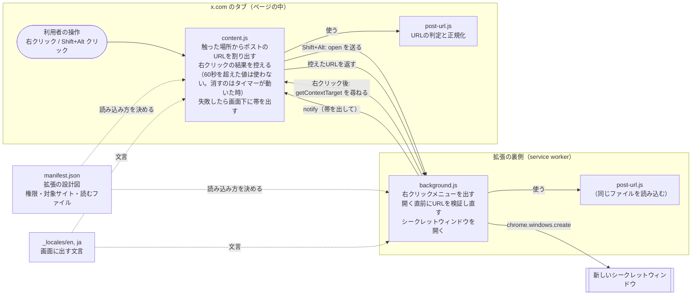
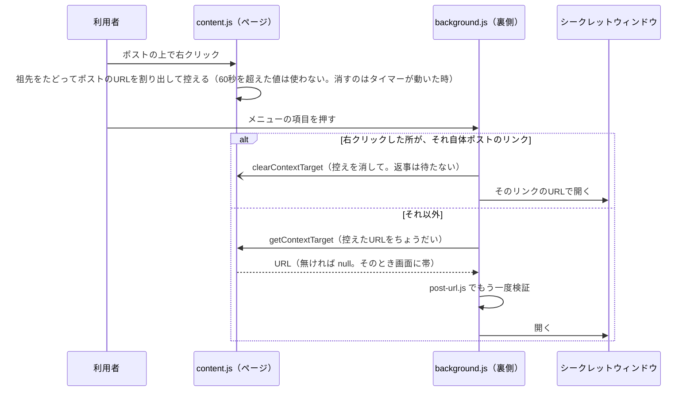
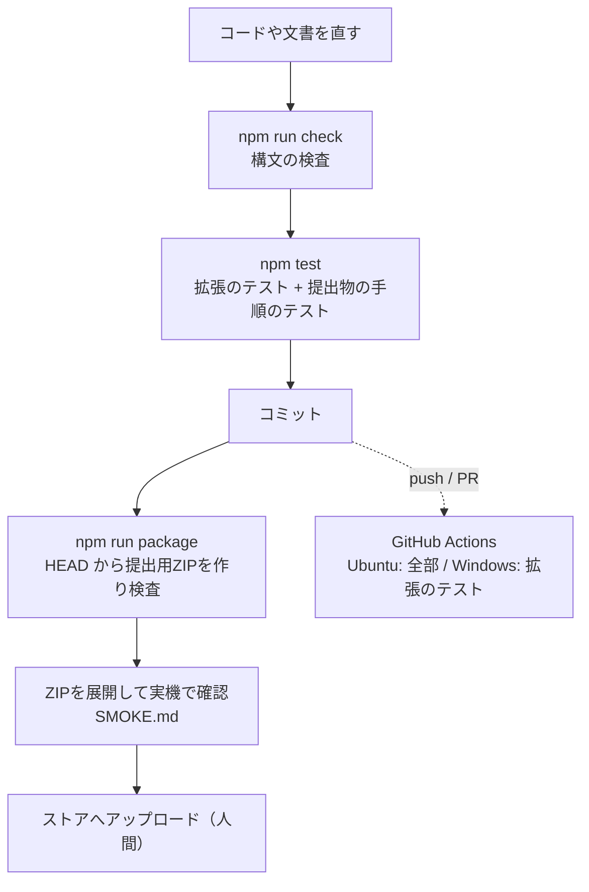

# PostCloak のしくみ（持ち主向けの解説）

この文書は、PostCloak のコードが「何をしているか」を、プログラムを書かない人にも追えるように説明したものです。
説明はすべて実際のファイルを読んで書き、**根拠のファイルとおおよその行**を `ファイル:行` の形で添えています。
行番号は、この文書を足したときのコミット（`main` の `179ab6b` と同じ中身）で数えたもので、コードが変わるとずれます。ずれていたら、根拠のファイルを正としてください。
読んでいない部分、確かめていない部分は「**未確認**」と書いています。

難しい言葉は [GLOSSARY.md](./GLOSSARY.md)（用語集）にまとめてあります。

---

## 1. ひとことで言うと

x.com のポストの本文は「リンク」ではないので、Chrome 標準の「シークレット ウィンドウで開く」が出ません（`README.md:13-15`）。
PostCloak は、利用者が触った場所から**そのポストのURLを割り出し**、**新しいシークレットウィンドウで開く**拡張です。

入口は2つあります。

- **右クリックメニュー**「このポストをシークレットウィンドウで開く」（`background.js:33-45`、`_locales/ja/messages.json` の `menuOpenInIncognito`）
- **Shift+Alt クリック**（`content.js:187-217`）

拡張そのものは外部のライブラリを一切使っておらず（`README.md:106`）、通信もしません（`PRIVACY.md:18-19`）。
開いたポストのページを X が受け取るのは、Chrome が普通にページを読み込むためです（`PRIVACY.md:20`）。

---

## 2. 全体の図

拡張の中は大きく3つの部品に分かれます。**ページの中で動く係（content script）**、**裏で待機している係（service worker）**、**URL を判定する共通の係（post-url.js）** です。

開発用の道具（テスト・提出用 ZIP 作り・CI）は拡張の中には入らず、別にあります。下の「5. 開発の流れ」で説明します。

---

## 3. ファイルごとの役割

リポジトリで管理しているファイルは、この文書を足す前は 28 個、足したあとは 31 個です（`git ls-files` で数えた）。
「配布」の列は、ストアへ出す ZIP に入るかどうかです（正本は `tools/package-files.txt:9-18`）。

### 3.1 拡張そのもの（ZIP に入る）

| パス | 役割 | 配布 | 根拠 |
|---|---|---|---|
| `manifest.json` | 拡張の設計図。名前・版（1.6.1）・権限（`contextMenus` と `scripting` の2つ）・対象の4サイト・最初に読むファイルを決める | ○ | `manifest.json:2-44` |
| `post-url.js` | 「この URL はポストか」を判定し、開いてよい形へ整える（正規化）。content script と service worker の**両方**が同じファイルを読む | ○ | `post-url.js:1-10`、`post-url.js:37-68` |
| `background.js` | service worker。右クリックメニューの登録、メニューが押されたときの処理、Shift+Alt からの依頼の受付、シークレットウィンドウを開く | ○ | `background.js:1-3` |
| `content.js` | x.com のページの中で動く。右クリック・Shift+Alt クリックの場所からポストのURLを割り出す。画面下の帯（通知）を出す | ○ | `content.js:1-3` |
| `_locales/en/messages.json` | 英語の文言（メニュー・通知）。ただし拡張の名前と説明は、公開中の掲載名を変えないために日本語のまま | ○ | `_locales/en/messages.json` の `extName` の `description` |
| `_locales/ja/messages.json` | 日本語の文言 | ○ | ファイル全体 |
| `icons/icon16.png` `icons/icon48.png` `icons/icon128.png` | 拡張のアイコン（16・48・128 ピクセル）。数式から描いた図形（コミット `cabb5fa` の説明）。画像の中身そのものは未確認（ファイル形式と大きさだけ確かめた） | ○ | `manifest.json:23-27` |
| `LICENSE` | MIT ライセンスの本文 | ○ | `LICENSE:1` |

### 3.2 テスト（ZIP に入らない）

| パス | 役割 | 根拠 |
|---|---|---|
| `test/post-url.test.js` | URL 判定のテスト。通すべき 21 形・弾くべき 24 形などを並べて確かめる | `test/post-url.test.js:12-69` |
| `test/content-script.test.js` | 偽物の DOM と偽物の chrome の上で `content.js` を実際に動かすテスト（40 件） | `test/content-script.test.js:3-7` |
| `test/background.test.js` | 偽物の chrome API の上で `background.js` を動かし、どの API をどう呼んだかを見るテスト | `test/background.test.js:3-6` |
| `test/manifest.test.js` | manifest と文言ファイルと実ファイルの食い違い、版の一致、**権限が2つのまま・対象が4サイトの完全一致のまま**であることを見る | `test/manifest.test.js:112-155` |
| `test/package.test.js` | ZIP に入れる一覧と manifest の突き合わせ。入れてはいけない物（README など）が混ざっていないこと | `test/package.test.js:36-87` |
| `test/run-unit-tests.test.js` | テストの起動係（`tools/run-unit-tests.js`）そのもののテスト | `test/run-unit-tests.test.js:1-10` |
| `integration/package-script.js` | 提出用 ZIP を作る手順（`tools/package.sh`）を、使い捨てのリポジトリで**実際に起動して**確かめるテスト（38 件）。わざと `test/` の外・テストらしくない名前に置いてある | `integration/package-script.js:1-10`、`tools/run-unit-tests.js:27-33` |

### 3.3 道具（ZIP に入らない）

| パス | 役割 | 根拠 |
|---|---|---|
| `package.json` | npm の設定。`npm test` などの命令の中身。依存パッケージは書かれていない | `package.json:7-12` |
| `tools/run-unit-tests.js` | テストの起動係。拡張のテストは Node に探させ、`--full` のときだけ提出物のテストも走らせる | `tools/run-unit-tests.js:4-5`、`:65-89` |
| `tools/package.sh` | 提出用 ZIP を作る手順。HEAD のコミットから作り、中身を何重にも検査してから最終的な名前で置く | `tools/package.sh:1-33` |
| `tools/package-files.txt` | ZIP に入れるファイルの一覧（**正本はここ1つ**） | `tools/package-files.txt:1-7` |
| `tools/fs-fault-shim.js` | テストのときだけ使う「わざと失敗を起こす差し込み」。製品のコードには何も足さない | `tools/fs-fault-shim.js:1-18` |
| `.github/workflows/ci.yml` | GitHub Actions（CI）。Ubuntu で全部、Windows で拡張のテストだけを走らせる | `.github/workflows/ci.yml:10-80` |
| `.gitignore` | git に入れないもの（`dist/`、`*.zip`、`node_modules/` など） | `.gitignore` 全体 |

### 3.4 文書（ZIP に入らない）

| パス | 役割 | 読んだ範囲 |
|---|---|---|
| `README.md` | 使い方・動く範囲・権限・開発の手順・完成度 | 全体 |
| `PRIVACY.md` | プライバシーポリシー（日本語と英語） | 日本語の部分（1〜95行）。**英語の部分が日本語と同じ内容かは未確認**（見出しだけ確かめた） |
| `STORE_LISTING.md` | Chrome ウェブストアの掲載文と申告内容の正本、更新を出す手順 | 1〜80行・144〜200行・255〜313行。**80〜144行（英語の掲載文）と 200〜255行（申告の判定）は未確認** |
| `SMOKE.md` | 実機（本物の Chrome）での確認手順と、過去の確認記録 | 全体 |
| `docs/ARCHITECTURE.md` | この文書 | — |
| `docs/GLOSSARY.md` | 用語集 | — |
| `CLAUDE.md` | このリポジトリで作業する AI のための決まり | — |

---

## 4. 主な処理の流れ

### 4.0 準備：拡張が読み込まれたとき

1. Chrome が `manifest.json` を読み、x.com など4サイトのページを開くたびに、`post-url.js` → `content.js` の順でページへ入れる（`manifest.json:28-42`）。
   順番が大事で、`content.js` は `post-url.js` が先に入っている前提で書かれている（`content.js:12-22`）。
2. `content.js` は同じ版が二重に動かないよう、印（`window.__postCloakLoaded`）を見てから始める（`content.js:8-10`、`:24`）。
3. 画面に出す文言を**読み込みの時点で**控えておく。拡張を更新したあとは文言の仕組みごと消えることがあるため（`content.js:28-50`）。
4. 裏側では `background.js` が `post-url.js` を読み込み（`background.js:7`）、インストール時と Chrome 起動時に右クリックメニューを作り直す（`background.js:33-45`）。
   メニューは4サイトのページでだけ出す（`background.js:17-22`、`:39`）。

### 4.1 右クリックメニューから開く

順を追うと次のとおりです。

1. **右クリックした瞬間**（`content.js:169-183`）
   - ページ側のプログラムが作った偽の右クリック（合成イベント）は無視する（`content.js:176`）。
   - 右クリックした要素から親へ親へとたどり（`content.js:130-145`）、
     - 途中にポストへのリンク（`<a>`）があればそれを採る（`source: 'link'`）
     - `<article>`（ポスト1件の箱）に着いたら、その中のタイムスタンプのリンクを採る（`source: 'fallback'`、`content.js:151-155`）
     - どちらにも着かなければ「ポストの外」
   - 結果を `lastContext` に控える。控えは 60 秒のタイマーつき（`content.js:53`、`:83-106`）。
2. **メニューの項目を押したとき**（`background.js:49-97`）
   - 別の項目やタブの無い場面なら何もしない（`background.js:50-54`）。
   - 右クリックしたフレームを名指しで扱う（`background.js:58`）。
   - **右クリックした所がポストのリンクだった場合**：そのURLをそのまま使う（`background.js:63-75`）。
     content.js 側に残っている控えは「消して」と頼むが、返事は待たずに開く（`background.js:72-73`、`:104-110`）。
     content.js は「同じURLで、しかもリンクの上で控えた値」のときだけ消す（`content.js:239-261`）。
   - **それ以外**：content.js に「控えたURLをちょうだい」（`getContextTarget`）と尋ねる（`background.js:79`）。
     content.js は控えを渡すと同時に捨てる。60 秒を過ぎていたら渡さず、画面に「ここにはポストがありません」の帯を出す（`content.js:222-234`）。
   - 返ってきたURLも、開く前に `post-url.js` でもう一度確かめる（`background.js:90-96`）。
3. **開く**：`chrome.windows.create({ url, incognito: true })` で**毎回新しい**シークレットウィンドウを開く（`background.js:154-161`）。
   開けなかったら（シークレットモードが禁止されている等）、画面に帯で知らせる（`background.js:157-160`、`:163-166`）。

### 4.2 Shift+Alt クリックで開く

1. クリックを受け取る（`content.js:187-217`）。
2. 合成イベントは無視する（`content.js:191`）。
3. Ctrl・Command・AltGr が一緒に押されていたら何もしない（Windows の AltGr 対策。`content.js:192-201`）。Shift と Alt の両方が無ければ何もしない（`content.js:202`）。
4. 右クリックと同じように親をたどるが、**ポスト以外のリンク（プロフィール等）に当たったらそこで打ち切る**（`content.js:116-123`、`:137`、`:205`）。本来のリンク移動を横取りしないため。
5. URL が見つからなければ何もしない。帯も出さず、普通のクリックとして通す（`content.js:206-208`）。
6. 見つかったら、ページ本来の移動を止め（`content.js:212-213`）、裏側へ `open` を送る（`content.js:214`）。
   送れなかったとき（拡張を更新した直後など）は「拡張とつながっていません」の帯を出す（`content.js:271-283`）。
7. 裏側は、送り主がタブであることと URL を確かめてから開く（`background.js:134-142`）。

### 4.3 インストール前から開いていたタブ（入れ直し）

Chrome は、拡張を入れる前から開いていたタブに content script を後から入れません（`background.js:81-83`）。
そのタブでメニューを押すと、尋ねる相手がいないので失敗します。そのとき：

1. `chrome.scripting.executeScript` で `post-url.js` と `content.js` をそのタブへ入れ直す（`background.js:114-121`）。
   `scripting` 権限を使うのは**この1か所だけ**（`PRIVACY.md:58`）。
2. 「準備ができました。もう一度お試しください」の帯を出す（`background.js:122-126`）。この回の操作は完了しない。

### 4.4 URL の判定（post-url.js）

`toPostUrl(href, base)` が、次の順で見ます（`post-url.js:37-68`）。

1. 文字列でなければ不可（`:38`）。URL として読めなければ不可（`:40-45`）。`base` を渡したときだけ相対URL（`/alice/status/123` のような形）を読む（`:35-36`、`:42`）。
2. `https` 以外、URL に埋め込まれた ID とパスワード、標準でないポート、4サイト以外のホストは不可（`:47-53`、ホストの一覧は `:16`）。
3. `/photo/1`・`/analytics` などの「派生ページ」の尻尾を1段だけ外す（`:31`、`:55-57`）。末尾の `/` も外す（`:59`）。
4. 残りが `/<ユーザー名>/status/<数字>`、`/i/web/status/<数字>`、`/i/status/<数字>` のどれかと完全に一致すれば、`https://<ホスト><パス>` を組み立てて返す。クエリ（`?` 以降）とフラグメント（`#` 以降）は入らない（`:22-26`、`:61-66`）。

### 4.5 控えの寿命（60秒）

右クリックの控えは、次のどれかで捨てられます。

- 一度渡したとき（`content.js:227`）
- 次に右クリックしたとき（作り直しの最初に消す。`content.js:84`）
- 60 秒のタイマーが動いたとき（`content.js:96-103`）
- 渡すときにも時刻を見て、60 秒を超えていたら渡さない（`content.js:228-232`）

タイマーには「世代番号」をつけ、古いタイマーが新しい控えを消さないようにしています（`content.js:76-106`）。

---

## 5. 開発の流れ（拡張の外側）

- 手順そのものは `STORE_LISTING.md:281-303` に書かれています。
- **提出用 ZIP の作り方**（`tools/package.sh`）：
  1. 必要な道具（zip・unzip・node・git・cmp）があるか（`tools/package.sh:81-87`）
  2. 作業中の変更が無いか。`git diff` だけでなく、変更を隠す印（assume-unchanged / skip-worktree）も見る（`:102-147`）
  3. 変更があれば止まる。`POSTCLOAK_ALLOW_DIRTY_PACKAGE=1` のときだけ、提出に使えない名前（`UNCOMMITTED`）で作る（`:149-174`、`:287-293`）
  4. 一覧と版は **HEAD から**読む（`:176-201`）。一覧の書き方そのもの（絶対パス・`..` など）も検査する（`:229-269`）
  5. `git archive` で HEAD の中身から ZIP を作る（`:310-334`）
  6. ZIP の中身が一覧と一致するか、HEAD とバイト単位で一致するかを確かめる（`:336-406`）
  7. 一時ファイルから最終的な名前 `dist/postcloak-<版>-<コミット12桁>.zip` へ置き、置いたあとの型と SHA-256 をもう一度確かめる（`:297`、`:418-466`）
- **テストの分け方**：`npm test` は全部、`npm run test:unit` は提出物の手順のテストを除いたもの（Windows でも走る）（`package.json:8-9`、`tools/run-unit-tests.js:65-89`）。
- **CI**：Ubuntu では check・test・`bash -n`・package・空白検査、Windows では check・test:unit（`.github/workflows/ci.yml:22-80`）。CI の実際の結果は、この文書では未確認（GitHub 上の実行記録は見ていない）。

---

## 6. この文書を書いたときに確かめたこと・確かめていないこと

**実行して確かめた**（Linux・Node.js 22.22.0・git 2.43.0・bash 5.2）

- `npm run check` が成功する
- `npm run test:unit` が 87 件すべて成功、`npm test` が 87 件 + 38 件すべて成功
- `bash -n tools/package.sh` が成功、`npm run package` が提出用 ZIP（10 ファイル）を作って成功
- `git diff --check` が成功

**確かめていない（未確認）**

- 本物の Chrome・本物の x.com での動き（この環境にはブラウザでの確認手段を使っていない。実機の記録は `SMOKE.md:111-121` にある）
- macOS（bash 3.2）や Windows での動き
- `PRIVACY.md` の英語部分と `STORE_LISTING.md` の一部（3.4 の表に記した範囲）
- テストの各項目が、ここに書いた説明どおりの中身を確かめているかの一件ずつの照合（テストの名前と冒頭は読んだが、`test/content-script.test.js` と `test/background.test.js` と `integration/package-script.js` の本体は全部は読んでいない）
